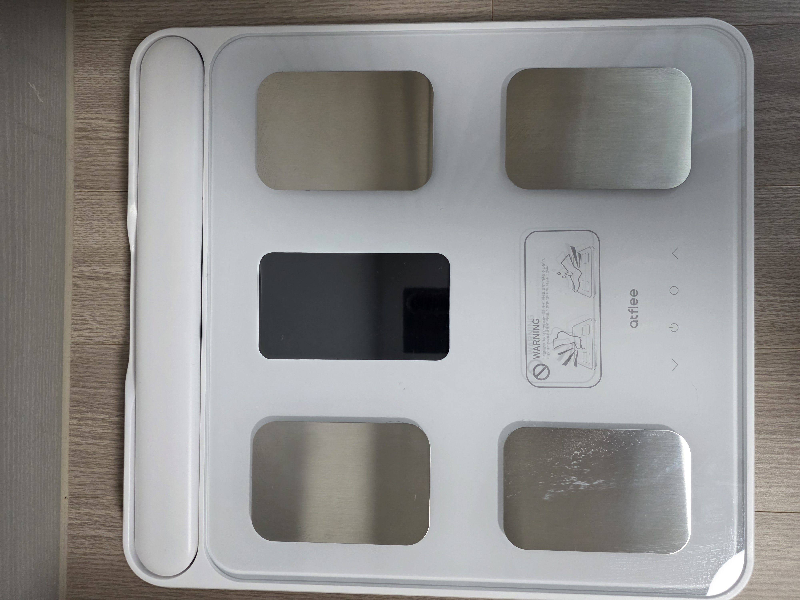

# 설정·사용자·엔티티 상세

[English](usage.md) · [시작 페이지](../README.ko.md)

## 연결·첫 설정

체중계를 잠깐 밟아 Bluetooth를 깨우고 HA **설정 → 기기 및 서비스**에서 발견된 Atflee를 설정합니다. 자동 발견이 없다면 **통합 추가 → Atflee**를 선택합니다. 첫 사용자 단계에서 이름·키·생년월일(`YYYY-MM-DD`)·성별과 선택적인 예상 체중을 입력합니다. 이 프로필은 기기의 체성분 계산 또는 통합의 계산에 사용됩니다. 설정 후 측정이 완료되어 HA에 전달될 때까지 체중계에 머무릅니다.

## 여러 사용자와 체중 식별

각 사람은 체중계의 **사용자 하위 항목**이며 사용자별 기기·센서를 가집니다. 통합의 **사용자 추가**로 등록하고 해당 사용자의 **재설정**에서 이름·키·생년월일·성별·예상 체중을 수정합니다.

- 체중계 기기의 **활성 사용자** 선택은 `auto` 또는 특정 사용자입니다. 연결 시와 다음 체중에 적용되고 측정 1회 완료 또는 10분 후 `auto`로 돌아갑니다. 재시작·재로드로 보존되지 않습니다. 첫 안정 체중으로 귀속이 결정된 측정을 나중에 옮기지는 않지만 그 전에 바꾼 선택은 적용됩니다.
- 통합 옵션의 **기본 사용자**는 `auto`의 기본 대상입니다. 비워 두면 가장 낮은 슬롯의 첫 사용자를 사용합니다.

두 명 이상이고 `auto`이면 첫 **안정 체중**으로 사용자를 정합니다.

1. 기준은 재시작 후에도 저장되는 최근 안정 체중이며, 아직 없으면 프로필의 **예상 체중**을 사용합니다. 둘 다 없는 사용자는 매칭 후보가 아닙니다.
2. 가장 가까운 기준 체중과의 차이가 **체중 매칭 허용 오차**(기본 3 kg) 안이고 다음 후보보다 최소 1.5 kg 가까워야 매칭됩니다. 그렇지 않으면 모호한 결과입니다.
3. 매칭 실패 시 기본 사용자로 귀속합니다(`assignment: fallback`). 단, 그 사용자의 기준과 **기본 사용자 최대 체중 차이**(기본 15 kg)보다 벌어지면 누구에게도 기록하지 않고 `atflee_unassigned_measurement` 이벤트를 발생시킵니다. 데이터는 `address`, `weight`, `timestamp`, `reason`(`no_candidates`, `out_of_tolerance`, `ambiguous`), 후보 `candidates`(`user_id`, `name`, `reference_weight_kg`, `difference_kg`)입니다. 알림·수동 귀속 자동화의 입력으로 사용할 수 있으나 이벤트 자체가 자동 귀속하지는 않습니다.
4. 활성 사용자를 선택하면 `assignment: selected`, 한 명뿐이면 `assignment: default`입니다.

안정되기 전 여러 사용자 `auto` 상태의 흔들리는 체중은 체중계 진단만 갱신합니다. 안정 체중은 다음 식별의 기준이 됩니다. 단 `fallback`은 저장/예상 기준이 전혀 없는 사용자에게만 기준을 설정하므로 방문자의 체중이 기본 사용자의 기준을 바꾸지 않습니다.

사용자 센서의 `assignment`는 `matched`, `fallback`, `selected`, `default`입니다. 안정 체중 전 선택된/단일 사용자에게 전달하는 값은 `assignment: null`입니다. 사용자 센서에는 해당 사용자의 측정 속성만 있으며 최근 원시 패킷·연결 정보는 체중계 센서에 있습니다. 사용자 삭제 시 기기·엔티티가 제거되고 저장 체중은 다음 통합 재로드에서 제거됩니다.

연결 시에는 아직 체중을 모르므로 선택/기본 사용자의 체성분 프로필을 기기로 보냅니다. 이후 다른 사용자로 매칭되면 기기가 제공한 체지방률은 폐기하고 식별된 사용자의 프로필과 원시 임피던스로 체지방·BMI 등 값을 통합이 계산합니다.

## 동작과 엔티티

통합은 광고를 듣고 측정 감지 시 연결하여 체중·체성분을 갱신합니다. 사용자별 기기를 생성합니다.

**사용자별:** 체중(kg)·임피던스(ohm)는 항상 존재합니다. 다음은 해당 사용자가 처음 값을 수신할 때 생성되므로 기기가 주지 않는 값의 unknown 센서를 계속 만들지 않습니다: BMI, 체지방률(%), 근육량(kg)/근육률(%), 내장지방, 피하지방률(%), 기초대사량(kcal), 골량(kg), 체수분률(%), 단백질률(%), 골격근률(%), 신체나이, 신체점수, 모델 지원 시 심박수(bpm). 파생 체지방량·제지방량·체수분량·단백질량·골격근량(kg)은 체중과 해당 비율로 계산합니다.

**평가 센서:** 해당 수치 센서와 함께 생성됩니다. 상태는 고정 slug이며 UI에서 번역합니다. 속성은 `value`, 정상 범위 `range_low`/`range_high`(상한은 다음 구간의 첫 값, 체수분만 상한 포함), 출처/버전 `standard`, `disclaimer`입니다.

| 센서 | 상태·범위 | 기존 참조 |
|---|---|---|
| BMI | underweight <18.5, normal 18.5–22.9, overweight 23–24.9, obese 1 25–29.9, obese 2 30–34.9, obese 3 ≥35 | KSSO 2022 아시아태평양 분류(Haam 외, J Obes Metab Syndr 2023) |
| 체지방 | low/normal/high/very high; 성별·20–39/40–59/60+ 구간(18–19는 첫 구간, 80+는 마지막) | Gallagher 외, Am J Clin Nutr 2000;72:694 |
| 내장지방 | normal 1–9, high 10–14, very high ≥15 | Omron/InBody 수준 관례. 자체 계산 척도를 다른 기기와 검증하지 않았으므로 참고용 |
| 체수분(기본 비활성) | low/normal/high; 남성 50–65%, 여성 45–60% 정상 | Tanita EU 범위, 신뢰도 낮음 |
| 신체점수(기본 비활성) | balanced ≥80 / unbalanced | InBody 점수 관례 |

체지방·체수분 평가는 사용자의 나이·성별이 필요하며 프로필이 유효하지 않거나 18–99세 밖이면 unknown입니다. 나이가 알려진 경우 BMI·내장지방·신체점수도 18–99세 밖에서는 평가하지 않습니다. 소비자용 생체임피던스 추정과 일반 참고 범위이며 의료 조언이 아닙니다. 건강 결정은 의료인과 상담하세요. 이는 기존 구현의 참조 설명이며 이번 공통화로 의학적 타당성을 새로 검증한 것이 아닙니다.

**프로필 진단:** 사용자 기기에 키·생년월일·성별을 표시합니다. 재설정하면 갱신되고 프로필이 유효하지 않으면 unknown입니다.

**체중계 기기:** 배터리(%), 연결(binary sensor), 연결 시간, Verify Status, Measure Status, Scale Status, 실패 횟수, 최근 실패, 전극 수, 활성 사용자(select), 체성분 측정(switch)입니다.

- 표준 BLE Device Information으로 모델·일련번호·하드웨어/펌웨어를 가져옵니다. 브랜드는 Atflee로 유지하며 수신 제조사 문자열은 전극 센서 속성에만 표시합니다. config entry 로드마다 백그라운드에서 한 번 읽고 실패/시간 초과 시 이후 세션에서 최대 3회 재시도합니다. 재시작 후에도 저장하며 정보가 없으면 일반 `BLE Scale` 모델입니다.
- 전극(4/8개)은 연결 시 장치 정보에서 읽습니다. 주파수·채널·심박/균형 지원 등 보고된 능력, `device_info_hex`, Device Information 문자열도 속성에 있습니다.
- Measure Status는 불안정 체중의 코드 1만 `weighing`으로 알려져 있으며 다른 코드는 `other`입니다. 실제 숫자는 `raw` 속성으로 보존하고 체중 안정 후에도 마지막 상태를 유지합니다.
- Verify/Scale Status는 프로토콜이 보내지 않고 의미가 확인되지 않아 숫자를 그대로 보존합니다. 새 설치는 기본 비활성이고 기존 활성 상태는 유지합니다.

## 통합 옵션

통합 **구성**에 유휴 연결 종료 시간, 체성분 스위치, 기본 사용자, 체중 식별 임계값(매칭 허용 오차·기본 사용자 최대 체중 차이)이 있습니다. 기기별 재시도·Debounce 같은 다른 통합의 옵션은 제공하지 않습니다.

## 0.3.2 이하에서 업그레이드

자동 migration은 없습니다. 이전 entry는 사용자가 없으므로 **사용자 추가** 전에는 체중을 기록하지 않습니다. 측정은 체중계 최근 패킷 진단에만 나타납니다. 키·출생연도·성별은 이관되지 않으므로 새 사용자에 다시 입력하세요. 이전 고유 ID `{address}_weight`, `{address}_body_fat` 등의 측정 엔티티는 더 이상 제공하지 않으므로 수동 제거합니다. 배터리·진단 엔티티 ID는 유지합니다.
